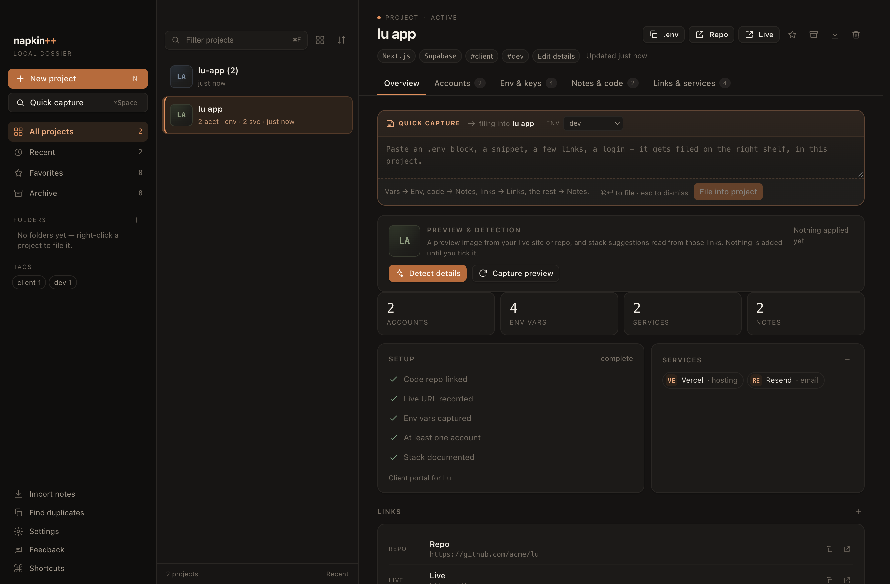
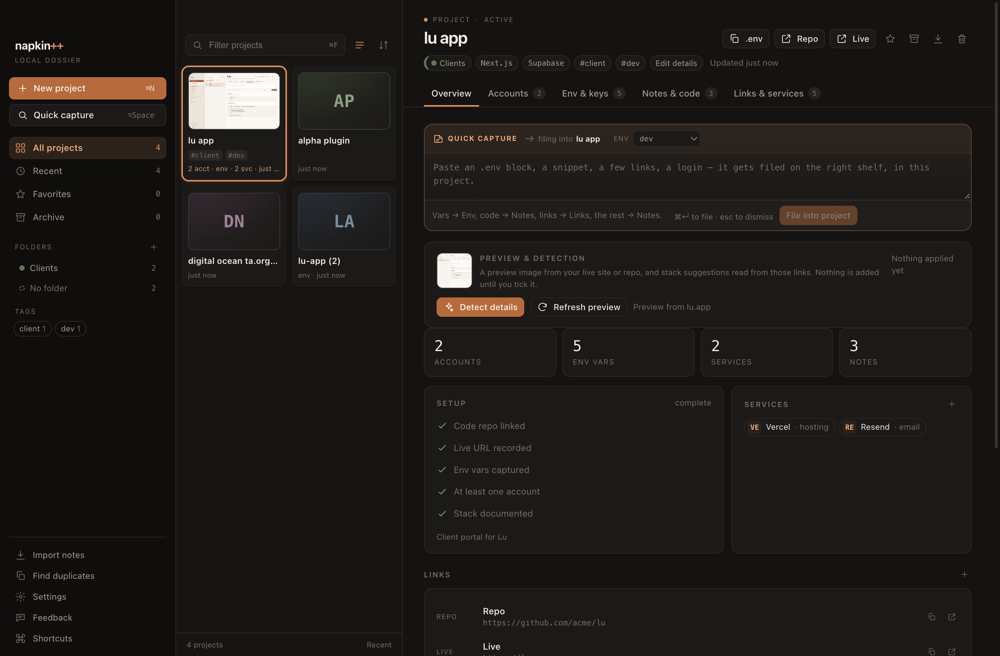
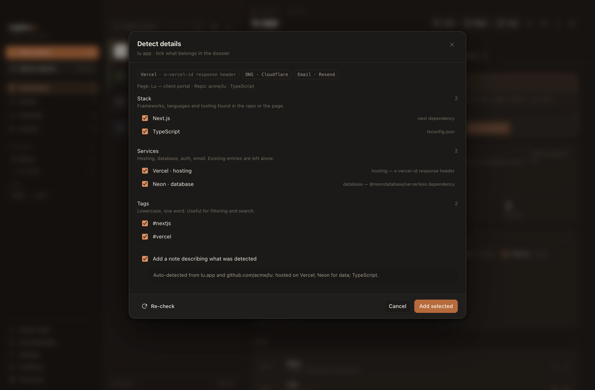
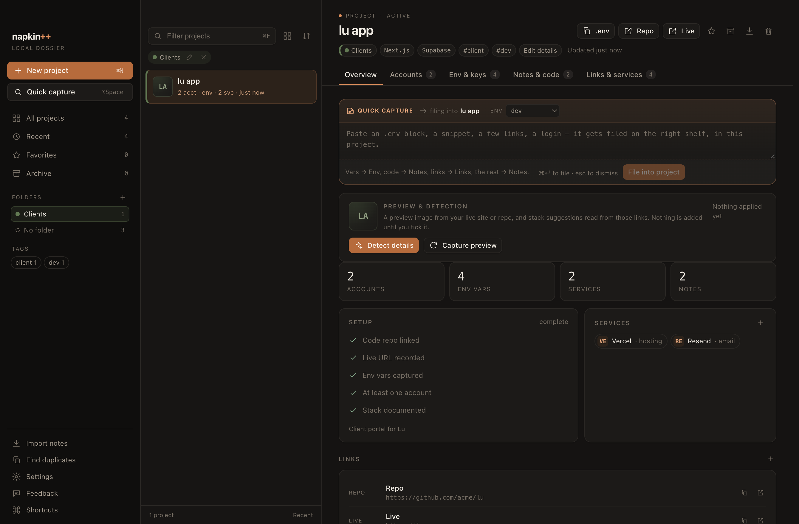
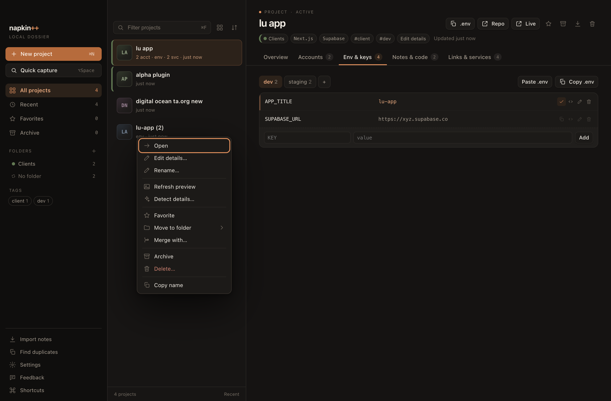

# napkin++

A local-first project dossier for developers. Every project gets one place for
its API keys, environment variables, logins, links, services, snippets and
stray notes — searchable in one keystroke, copyable in one click, and now
recognisable at a glance.

Named after the napkin you scribble on, and the editor you used to write HTML
by hand. The point is not to be a password manager. The point is to be the
thing you actually reach for while building.



## Run it

```bash
npm install
npm start
```

macOS 13 or newer (hidden-inset title bar, Dock icon, `⌥Space` global summon).
The app opens with an empty vault; press `⌘N` or `⌥Space` to start.

### Install it as a macOS app

```bash
npm run package
open "dist/napkin++-darwin-arm64/napkin++.app"
```

`npm run package` builds the host architecture (or `NAPKIN_ARCH=universal npm
run package`), ad-hoc signs it, and writes a versioned zip plus
`dist/SHA256SUMS.txt`. Move `napkin++.app` to `/Applications` before enabling
login startup so the registered path stays put.

The default build is ad-hoc signed and not notarized, so it launches locally
without a Gatekeeper prompt; if macOS objects after copying it between machines,
right-click the app and choose Open. Setting `APPLE_ID`,
`APPLE_APP_SPECIFIC_PASSWORD` and `APPLE_TEAM_ID` with a Developer ID identity in
the keychain upgrades the same script to a hardened, notarized build.
`npm run notarize:check` says what is already in place and what is missing;
[docs/NOTARIZATION.md](docs/NOTARIZATION.md) has the click-by-click for the
certificate, Team ID and app-specific password. See
[docs/RELEASING.md](docs/RELEASING.md) for the runbook and the current limits of
in-place updates.

The dev copy (`npm start`) and the packaged app share the same vault and the
same single-instance lock. Quit one before opening the other. The packaged app
is the one to use day to day.

## What it does

**Projects as dossiers.** Name, aliases, tags, stack, status. A project can be
as small as a name; everything else can be added as you learn it.

**A preview per project.** Add the live URL or the repo and napkin++ keeps the
page's social preview image beside the vault. Projects without one get a paper
letter tile. Switch the list to a thumbnail grid with `⌘⇧G`; the choice sticks.



**Detection that asks first.** A repo link is read for languages, frameworks
and services (`package.json`, lockfile-free file tree, `vercel.json`,
`prisma/schema.prisma`, `.env.example`). A live link is read for response
headers, markup and DNS — Vercel, Netlify, Cloudflare, Namecheap, Route 53,
Neon, Supabase, Clerk, Stripe, Resend, Google Workspace… The result arrives as a
sheet with the evidence beside every suggestion. Nothing is written until you
tick it, and applying never replaces what you already recorded.



**Many accounts per project, all visible.** Test users, client logins, dev/prod
identities. Each account carries typed fields — Password, PIN, API token,
recovery code — instead of a single fixed password column. Fields are masked,
revealable, copyable, and searchable from the palette.

**Env vars per environment.** `dev`, `staging`, `production`, or your own. Paste
a `.env` block and it becomes key/value rows; copy one value, one `KEY=value`
line, or the whole `.env`. Click a value to copy it — the tick stays there for
the session. Right-click (or double-click) a row to edit it in place; `↵` saves,
`esc` puts it back.

**Notes and code with line numbers and folding.** Paste a snippet, a curl
command, a SQL query or a recovery-code list. Brace folding for JS/CSS/JSON,
indentation folding for Python/YAML. Secrets stay masked until revealed.

**Links and services.** Repo, live, staging, docs, dashboard links; Vercel,
Railway, Neon, Supabase, Clerk, LiveKit, Resend, Brevo… with one-click open and
copy.

**Search everything (`⌘K`).** Weighted fuzzy search across projects, accounts,
credential fields, env vars, notes, links and services. Arrow keys move, `↵`
opens, `⌘↵` copies the value in place. `#tag`, `type:account`, `type:cred`,
`project:lu` filters work.

**Quick capture (`⌥Space`).** A Spotlight-style panel from anywhere. Type
`lu app` and press `↵` to create it, or paste a `.env` block and press `↵` to
add the variables to the last project. `⇥` cycles Project / Note / Secret / Env.
It prefers opening an existing near-match over creating a duplicate.

**Project capture, right where the project is.** The Overview tab starts with a
capture box that says it is filing into *this* project. Paste an `.env` block, a
snippet, a few links, a login line and some stray prose all at once: vars go to
Env, code becomes a snippet, URLs become links, logins become accounts, and the
rest becomes a note. The chips under the box tell you where each part will land
before you press `⌘↵`.

**Folders with a colour.** Group projects into folders; the colour is a quiet
left border in the project list rather than another badge. Drag a project onto a
folder, right-click → Move to folder, or set it in Project details. Click a
folder to filter the list; drop onto “No folder” to take it back out.



**Right-click where you are.** Projects have a real context menu: open, edit
details, rename, favorite, move to folder, merge, refresh preview, detect
details, archive, delete, copy name. Variables, accounts and folders have one
too. Renaming keeps the old name as an alias.



**Merge on your terms.** “Merge with…” lets you pick which project survives and
tick exactly which ones fold into it, then choose the surviving name from any of
the candidates. Old names become aliases; links, services, env sets, accounts and
notes union. Test accounts are never silently collapsed, and duplicate env keys
keep the surviving project’s value — the merge says how many.

**Bring your old napkin.** Paste or choose your old text file. It splits on
dashed rules, Markdown headings and blank-line blocks — or keeps the whole file
as one project — previews every block with line counts, and imports only the
ones you keep. Links, services, env vars and logins are detected on the way in.

**Light and dark.** Follows macOS by default; override in Settings.

**Make it yours.** System/light/dark, eight paper palettes (Paper, Slate, Nord,
Forest, Ocean, Rose, Sand, Graphite) with a light and a dark version each, four
preset accents plus any hex colour you like, and six Dock icon colourways on top
of the four icon forms. The icon sits at a slight angle, like a napkin dropped on
the desk. Right-click the Dock icon for Quick Capture, Search, New Project and
Settings without hunting for the window. In the packaged app, Settings also has
**Open at login** — it starts hidden in the menu bar. The menu-bar icon opens
quick capture, search, settings, and quit.

**Tell me when it breaks.** Feedback & bugs (sidebar, or Help menu) writes a
report you send yourself: a prefilled GitHub issue, an email, or the clipboard.
Diagnostics are version, macOS, settings, counts and the last renderer error.
Never project names, links or secret values.

**Updates, honestly.** About & updates checks GitHub Releases once a day, shows
the version and download size, and can skip a release. This build downloads and
replaces; it does not install silently, because that needs a Developer ID
signature and notarization.

## Keyboard

| Keys | Action |
| --- | --- |
| `⌘K` | Search everything |
| `⌘N` | New project |
| `⌥Space` | Quick capture (global; falls back to `⌥⇧Space` / `⌃⌥Space` if taken) |
| `⌘⇧N` | Quick capture from the app |
| `⌘↵` | File the project capture box |
| `esc` | Cancel an edit / dismiss the capture box |
| `⌘F` | Filter the project list |
| `⌘⇧G` | List / grid |
| `⌘1`–`⌘5` | Overview / Accounts / Env / Notes / Links |
| `⌘Z` | Undo the last vault change (outside text fields) |
| `⌘↵` | Copy the selected palette result (in the palette) |
| `⌘,` | Settings |
| `⌘/` | Shortcut sheet |
| `↵` / `⇧↵` | Save / newline in quick capture |

## Where your data lives

```
~/Library/Application Support/napkin++/
  vault.json            # the whole vault, plain JSON
  backups/
    vault-YYYY-MM-DD.json   # one per day
    vault-prev.json         # the immediately previous save
  previews/
    prj_<id>.png            # one social preview per project
  update-check.json         # the last release check (no identifier)
```

Writes are atomic (`vault.json.tmp` → `fsync` → rename). A damaged vault is
kept as `vault.corrupt-<timestamp>.json`, and the newest backup is restored
automatically. Undo is session-scoped (last 30 states) and persisted only as
the resulting vault, not as a history log.

**Threat model, stated plainly:** the vault is plaintext on disk. It is not
synced and not shared. It protects against the "one giant text file" problem,
not against someone with access to your unlocked Mac. Turn on FileVault.
Encryption at rest is the obvious next step and is not in this version.

**What leaves the machine, and when:** nothing, unless you ask. Previews and
detection fetch the URLs you recorded (site HTML, its preview image, DNS
records, and for GitHub the repo metadata/tree/raw files via api.github.com).
The update check asks GitHub for the latest release once a day. There is no
telemetry, no account and no analytics. Both behaviours can be turned off in
Settings; `NAPKIN_OFFLINE=1` disables all of it for tests. Local and private
addresses are refused, responses are size-capped, and previews are images the
site already publishes — never a screenshot of a signed-in page.

Export any project — or the whole vault — as Markdown from the project header
or Settings. Export is redacted by default (hidden fields and secret entries);
opening the JSON is the unredacted path.

## How it is built

```
main.js              Electron main: owns the vault, IPC, shortcut, Dock menu, clipboard timer
preload.js           explicit contextBridge API (no Node in the renderer)
app/config.js        product, repo, site and feedback addresses in one place
app/model.js         pure schema + reducer + merge/dedupe + folders (shared with browser)
app/search.js        flat weighted index + fuzzy matching + filters
app/parse.js         .env, account lines, URL lists, blob splitting, capture routing
app/detect.js        pure link intelligence: headers, DNS, repo files → suggestions
app/inspect.js       collects those signals (HTTP, DNS, GitHub API) for one project
app/net.js           capped fetches, redirect checks, private-address refusal
app/previews.js      og:image capture, resize, cache beside the vault
app/updates.js       pure semver + release/asset selection
app/feedback.js      redacted diagnostics, issue/mailto/clipboard report
app/fold.js          brace + indentation folding
app/store.js         atomic persistence, backups, recovery, undo
app/dom.js           escaping, icons, initials, relative time, highlighting
app/app.js           renderer controller (three panes, palette, dialogs, context menus)
app/quick.js         quick capture window
app/styles.css       the design system (light/dark, palettes, accent tokens)
app/quick.css
assets/icons/        Paper / Ink / Grid / Classic dock icons × six tints (1024 + 128)
assets/trayTemplate*.png  monochrome menu-bar glyph
scripts/make-icons.js     renders icons from scripts/icon.html
scripts/make-og.js        renders the 1200×630 social card from scripts/og.html
scripts/make-site-shots.js crops smoke screenshots into site/assets/shots
scripts/check-site-links.mjs  internal-link check used by CI
scripts/package-macos.sh  packager + ad-hoc signing (or notarization) + zip
scripts/verify-release.sh check + test + smoke + package + packaged smoke
site/                napkinplusplus.app (static, no build step)
site/api/contact.js  the one server function: the contact form, via Resend
tests/               node:test suites for the pure layers
```

The renderer never edits the document directly: it dispatches actions, the main
process applies them through the pure reducer, saves, and broadcasts the new
state to every window. Two windows can therefore never clobber each other.

### Verify it

```bash
npm run check      # node --check every source file
npm test           # unit tests (model, search, parse, folding, store, detect,
                   # updates, feedback, dom)
npm run smoke      # real Electron boot against a temp vault, UI checks across
                   # every screen, writes screenshots to docs/, exits non-zero
                   # on failure
npm run verify     # check + test + smoke
bash scripts/verify-release.sh   # …plus package, bundle identity, signature,
                                # and a smoke run inside the built .app
```

`npm run smoke` opens a window briefly and always uses a throwaway vault; set
`NAPKIN_DATA_DIR` to choose the directory yourself and `NAPKIN_SHOT_DIR` to move
the screenshots. It runs offline (`NAPKIN_OFFLINE=1` is set by the verification
scripts) and uses `tests/fixtures/detect.json` for the detection sheet, so it
never depends on a live site.

## Known limits

- No encryption at rest, no sync, no sharing.
- No TOTP generation; recovery codes are just notes.
- The packaged build is ad-hoc signed unless you provide notarization
  credentials. There is no silent auto-install; updates are checked and linked.
  The build targets the architecture you ask for (`arm64`, `x64` or `universal`).
- The dev copy and the packaged app share a vault and single-instance lock; quit
  one before launching the other.
- Quick capture targets the last-used project; switch with the project picker.
- "Keep separate" on a near-identical name appends ` (2)`; aliases are cleaner.
- Attachments are not supported.
- Folders are one level deep; a project lives in at most one folder.
- The copied-field ticks last for the session, not across relaunches.
- The Dock menu needs the app to be running; macOS owns the icon's other items.
- Previews need a page that publishes an Open Graph / Twitter image. Sites
  behind a login, or with none, keep the letter tile.
- Detection is inference, not an inventory: monorepos, private repos and
  serverless env vars set only in a dashboard will be partly invisible. The
  GitHub API allows 60 requests an hour without a token; add one in Settings if
  you detect often.
- The site and in-app feedback share `hello@napkinplusplus.app`; the GitHub slug
  and domain live in `app/config.js` and `site/assets/config.js`.

## Why these choices

See [docs/design.md](docs/design.md) for the product reasoning: why projects are
dossiers, why accounts are a list, why the palette is the real navigation, and
what was deliberately left out.
